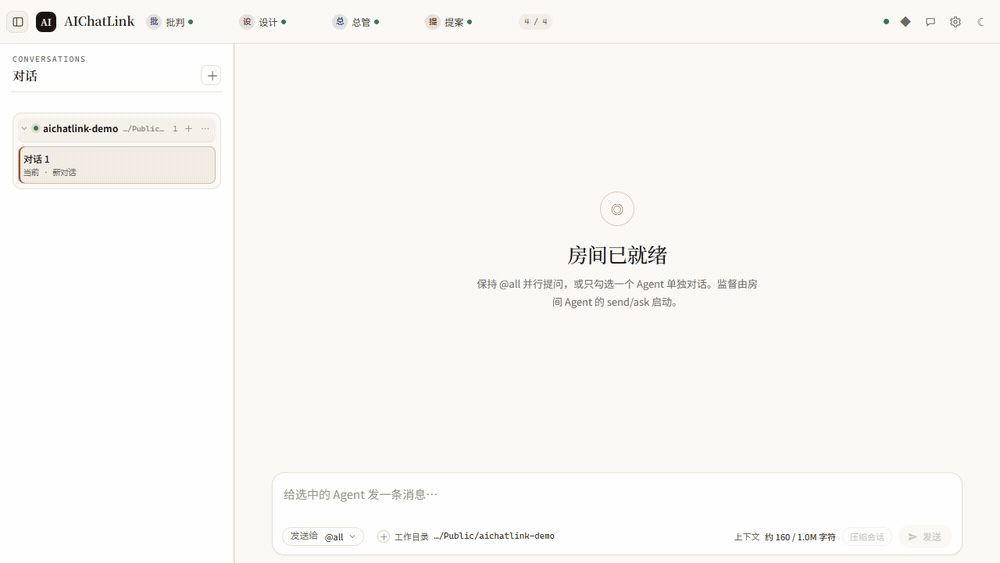

<div align="center">

# ⚡ AIChatLink

**把 Codex、Grok、Claude Code、pi、WorkBuddy 放进同一个本地 Agent 房间。**

一个 Web UI，统一完成群聊路由、会话恢复、上下文压缩与本地记忆。




<sub>本机多窗格实录：四格各绑定一个 pi Agent，同一个问题并行路由，四路回复分别落进各自窗格并同时持久化。为了让仓库不含真实对话，画面录制自一个隔离的本地演示房间（独立 SQLite 与工作目录、端口 4312）；界面与交互是本仓库构建的真实产物。</sub>

</div>

## 这是什么

AIChatLink 是一个只监听本机 loopback 的多 Agent 群聊 Broker。用户从浏览器发消息，Broker 把消息显式路由给一个或多个本地 CLI Agent，并把公共对话、Turn 状态、记忆与上下文摘要保存在本地 SQLite。

它不替代任何 CLI，也不接管它们的凭据：每个 Agent 是自己原生进程，用自己第一方协议入口通信（App Server / ACP / stream-json / RPC），AIChatLink 只做三件事——**路由、归并、持久化**。

四个定位事实：

- **本机**：Web/API 只绑 `127.0.0.1`，没有云端中转，没有账号体系。
- **透明**：按固定 `unrestricted` profile 启动原生 CLI，不写用户的全局配置文件，不额外加审批层。
- **单一事实源**：Broker 是唯一写库方，CLI 进程从不直接写数据库。
- **显式**：模型正文里说「让 Claude 看看」不会触发任何调用，只有工具调用或用户在 UI 上选择目标才会派发。

## 支持的 Agent

当前支持的适配集合（`transport: "structured"`）：

| Agent | driver | 第一方协议入口 | 本机验证状态 |
| --- | --- | --- | --- |
| Codex | `codex` | `codex app-server --listen stdio://` | `verified`：真实回合、工具调用、MCP 互调 |
| Grok | `grok` | `grok agent stdio`（ACP） | `verified`：真实回合与跨 Agent 派发 |
| Claude | `claude` | `claude --print --input-format stream-json --output-format stream-json` | `probed`：2.1.295 握手与权限模式建立通过；本机模型通道返回 400，成功回合未观测 |
| pi | `pi` | `pi --mode rpc`（JSONL 命令/事件） | `verified`：0.99.2 真实回合、上下文保留、房间内 MCP `read` 实调 |
| WorkBuddy | `workbuddy` | 桌面版内置 `codebuddy-lite-wb.mjs --print … stream-json` | `probed`：2.165.0 握手 / `init` / 取消路径通过；未登录，回合按 `TURN_INTERRUPTED` 失败 |

`kimi` / `hermes` 的 ACP driver 仍可加载，仅用于兼容既有 `aichatlink.json`，不属于当前支持集合，也不参与新配置的引导。历史 `direct` transport 没有运行入口，任何入口都会在打开运行时资源之前拒绝。

## 主要能力

**Agent 名册**：可添加、禁用、改名 Agent，也能为同一个 driver 建多个独立实例（例如两个 Codex 跑不同工作目录）。每个启用的 Agent 拥有独立原生进程与会话，互不共享上下文。

**多工作目录**：主目录由配置的 `workspace` 定义，其余目录从输入器 `＋` 或侧栏组头添加。每个目录是一个独立 runtime（独立 SQLite、MCP 绑定、Agent 会话），主界面用 `?ws=` 统一代理；切走目录不会停掉那边的回合。

**显式路由**：选择单个 Agent、多个 Agent 或 `@all` 发送。点名册项会把收件人换成那个 Agent（替换式，不是叠加），回全员需显式点 `@all` 或「全选」。回复可引用具体消息继续追问；Agent 之间通过 MCP 工具互相派活（见下文工具表）。

**房间助理**：与用户平级的 `user:assistant` 操作员客户端，侧边对话不进群时间线，可用独立的 `/mcp/operator` 控场或派活。它不是名册 worker，也不是审批层。

**共享时间线**：SSE 实时展示回复、推理与工具进度，工具记录折叠在所属 Agent 气泡内；最终回复、聚合推理与工具记录写入 SQLite，刷新后可回放。

**旧对话可以接着说**：点击已关闭的对话先只读回放（含它续自的种子），第一条新消息经 `POST /api/conversations/resume` 把它续成新纪元——原 transcript 与 `/api/events` 不改写，Agent 的 Context Packet 里多一段 `[resumed_conversation]`。

**对话目录**：只列你在本次对话里发过的消息，点条目跳到原位置并短暂高亮，长对话不用自己滚。

**上下文引擎**：输入框右上角显示当前字符预算，达到 75% 软目标时自动滚动摘要，也可手动压缩；完整 transcript 不会被删除。

**三层记忆**：房间公共记忆（用户显式固定）、Agent 核心记忆（Agent 主动维护）、Agent 日期记忆（成功回合按日批量整理）。

## 快速开始

前置条件：

- Node.js `>=24.14.1 <25`；
- 至少安装并登录 `codex`、`grok`、`claude`、`pi`、`workbuddy` 中的一个 CLI。

**从源码运行（当前唯一方式）**：`@aiyao/aichatlink` 尚未发布到 npm。

```bash
npm ci
npm run build
npm start
```

想让 `aichatlink` 在任意目录可用，在仓库根执行一次：

```bash
npm link
aichatlink start
```

首次启动会打开 Agent 引导页（`/setup`）。添加 Agent、填好工作目录与命令并保存后，页面进入群聊，默认地址 [http://127.0.0.1:4310/](http://127.0.0.1:4310/)。

> `aichatlink` 默认读取**当前目录**的 `aichatlink.json`，工作目录为 `.`。换目录启动时请显式给 `--config <路径>/aichatlink.json`，否则会当成一个新房间重新进入引导流程。

## 命令

```bash
aichatlink start                   # 启动，或复用同配置的现有实例
aichatlink start --no-open         # 启动但不自动打开浏览器
aichatlink start --config x.json   # 使用指定配置文件
aichatlink stop                    # 优雅停止当前 aichatlink.json 对应的实例
aichatlink restart                 # 优雅关闭并按最新配置重载
aichatlink init                    # 打开 Agent 配置引导页
aichatlink doctor                  # 检查 Node 与七种 driver 的本机命令
aichatlink update --check          # 只检查 npm 更新
aichatlink update                  # 更新当前全局安装
```

`stop` / `restart` 只处理 **canonical 配置路径相同、且仍监听该配置 `server.port`** 的实例；配置内容刚改过不影响识别。它们不会终止另一配置、旧版本或其他程序占用的端口，也不会偷偷换端口启动。

改完名册不会热替换正在运行的会话：保存后主房间立即合并新名册并刷新数量，新增但未启动的 Agent 显示为「等待重启」，执行 `aichatlink restart` 后转为可用。`aichatlink stop` 或 `Ctrl+C` 会有界关闭 runtime，不删除 SQLite 数据。

## 配置参考

推荐用引导页或右上角「Agent 设置」维护。配置文件是 strict schema，出现未知字段会直接报错。

```json
{
  "transport": "structured",
  "workspace": ".",
  "server": { "host": "127.0.0.1", "port": 4310 },
  "storage": { "path": ".aichatlink/aichatlink.db" },
  "agents": {
    "codex": { "name": "Builder", "command": "codex", "enabled": true },
    "reviewer": {
      "driver": "codex",
      "name": "Reviewer",
      "command": "codex",
      "cwd": "review-worktree",
      "enabled": true
    },
    "pi": {
      "command": "pi",
      "model": "<provider>/<model>",
      "thinking": "high",
      "piConfig": "shared",
      "enabled": false
    }
  }
}
```

| 字段 | 说明 |
| --- | --- |
| `transport` | 只接受 `structured` |
| `workspace` | 房间主工作目录；Agent 与助理省略 `cwd` 时跟随它 |
| `server.host` / `server.port` | 只接受 `127.0.0.1`，默认端口 `4310` |
| `storage.path` | SQLite 路径，默认 `.aichatlink/aichatlink.db` |
| `agents.<id>` | 键是稳定 Agent ID；内置 ID 可省 `driver`，自定义 ID 必须声明 |
| `agents.<id>.driver` | `codex` / `grok` / `claude` / `pi` / `workbuddy`（`kimi` / `hermes` 为 legacy） |
| `agents.<id>.identity` | 每轮注入的群内身份说明，最多 32,768 字符 |
| `agents.<id>.model` / `.thinking` | 原生模型 id 与推理强度，只通过 argv / thread 配置生效 |
| `agents.<id>.piConfig` | 仅 pi：`isolated`（默认）或 `shared` |
| `agents.<id>.order` | 名册显示顺序（0–9999）。只影响顶栏、活动栏与窗格铺设顺序，不改变派单优先级；缺省按 id 排序，排在有 `order` 的之后 |
| `agents.<id>.command` | 字符串，或 `{ "executable": "...", "prefixArgs": [...] }` |
| `agents.<id>.cwd` / `.enabled` | 工作目录；缺省 enabled 为 `true` |
| `assistant` | 房间助理：`enabled`、`name`、`brain.driver`、`brain.command`、`brain.cwd`、`extraInstructions` |
| `limits` | 见下表 |
| `timeouts` | 见下表 |

**limits 默认值**

| 字段 | 默认 | 含义 |
| --- | --- | --- |
| `messageCharacters` | `131072` | 单条消息（草稿）字符上限 |
| `contextCharacters` | `1000000` | Context Packet 字符预算，75% 处触发压缩 |
| `queuePerAgent` | `64` | 每 Agent 排队回合上限 |
| `rootTurns` | `48` | 单次根 Turn 上限 |
| `hopCount` | `24` | Agent 间转发跳数上限 |
| `actorCallsPerRoot` | `16` | 单根 Turn 内每个 Actor 的调用上限 |
| `steersPerSubjectTurn` | `3` | 单个 Subject Turn 允许的 steer 次数 |
| `sseEvents` / `sseBytes` | `512` / `2097152` | SSE 单帧缓冲 |

**timeouts 默认值（毫秒）**：`handshakeMs` 15000、`requestMs` 10000、`firstEventMs` 180000、`idleMs` 300000、`cancelMs` 10000、`closeMs` 5000、`askMs` 120000、`watchMs` 120000。

## 各 driver 说明

所有 driver 共享同一条纪律：按厂商第一方协议入口通信；不通过 shell 拼命令（一律 argv 数组、Windows 下隐藏子进程）；原生交互请求（审批 / 权限 / `requestUserInput` / elicitation）一律让当前 Turn 以 `UNEXPECTED_NATIVE_INTERACTION` 失败并做有界取消，不转交 UI、不自动决策。

### Codex

固定的 unrestricted 启动形状：`codex --dangerously-bypass-hook-trust app-server --listen stdio://`，选中的模型与推理强度作为 `-c model=…` / `-c model_reasoning_effort=…` 追加；线程级 `approvalPolicy: "never"` 与 `sandbox: "danger-full-access"` 通过协议下发，不写用户配置。`dynamicTools` 与 App Server WebSocket 都不在本版本的依赖路径上。

### Grok

`grok --no-auto-update --permission-mode bypassPermissions --sandbox off --no-plan agent stdio`（ACP）。模式由 argv 固定，不读取也不改写用户的全局设置。

### Claude

固定形状：`claude --print --input-format stream-json --output-format stream-json --verbose --include-partial-messages --permission-mode bypassPermissions`；存在 MCP 绑定时追加 `--mcp-config <json>`，末尾追加 `--session-id <uuid>`（新建）或 `--resume <uuid>`（恢复），选中模型与推理强度用 `--model` / `--effort`。

Claude Code 的 `system`/`init` 帧在首条用户消息之后才发出，所以 `unrestricted` 由 SDK control request 建立：先 `initialize` 观测 `current_permission_mode`，再 `set_permission_mode` 建立 `bypassPermissions`，不消耗模型回合；只有 set 被拒绝或降级才记为 `NATIVE_POLICY_BLOCKED`。取消走 `interrupt`，进程可继续用于下一回合。

命令解析顺序：Windows 为 `PATH` → `%USERPROFILE%\.local\bin\claude.exe` → npm 全局 `@anthropic-ai/claude-code/cli.js`（经 node 启动）；POSIX 为 `PATH` → `$HOME/.local/bin/claude` → 当前 Node 前缀 / Homebrew / `/usr/local`。

### pi

`pi --mode rpc --session-id <id> [--provider <p>] [--model <m>] [--thinking <level>]`，JSONL 命令与事件。`--session-id` 由 AIChatLink 指派，恢复前先确认原生 session 文件存在。终态只认 `agent_settled`；`agent_end` 不结束 Turn，`stopReason="error"` 一律记为失败，没有本轮运行事件佐证的迟到 `agent_settled` 会被丢弃。pi 会读工作区的 `AGENTS.md` / `CLAUDE.md`。

AIChatLink 为每个房间 Agent 生成独立的 `.aichatlink/pi-agents/<agent-id>/` 并通过 `PI_CODING_AGENT_DIR` 注入，**不写** `~/.pi/agent`；目录自带 `.gitignore`，会话关闭时删除生成的凭据副本。配置面按 Agent 二选一：

| `piConfig` | 行为 |
| --- | --- |
| `isolated`（默认） | 只带裁剪后的 `models.json`（一个 provider）、最小 `settings.json`、AIChatLink MCP 条目；用户的扩展 / 包 / 子 agent 名册不加载 |
| `shared` | 复制用户的 `settings.json`、完整模型目录、`auth.json` / `mcp-auth.json` / `models-store.json`，并把 `extensions/`、`agents/`、`skills/`、`prompts/`、`themes/`、`npm/` 链接进角色目录；`mcp.json` 与 `sessions/` 仍按 Agent 独立 |

`shared` 下唯一默认剔除的包是 `pi-open-tui`——它调用只存在于 TUI 运行时的 `registerToolRenderer`，在 `--mode rpc` 下会让进程启动即失败。需要额外剔除时用 `AICHATLINK_PI_DROP_PACKAGES=a,b`。未写 `piConfig` 时读取 `AICHATLINK_PI_CONFIG`，仍未设置则 `isolated`。

> `shared` 会把明文 API Key 与 OAuth 凭据复制进 `.aichatlink/pi-agents/<id>/`。该目录已 gitignore 且权限 0600，但它确实是明文副本。

仓库内 `tools/pi-driver/` 保留了早期把 pi 接成 Claude-shape 角色的垫片，可用但不代表 pi 的协议事实，新配置请直接用 `driver: "pi"`。

### WorkBuddy

桌面版内置 CodeBuddy CLI 的 stream-json 入口（Windows 默认解析 `%LOCALAPPDATA%/Programs/WorkBuddy/resources/app.asar.unpacked/cli/dist/codebuddy-lite-wb.mjs`）。

该 CLI 在首个会话前对 `set_permission_mode` 返回 `Session not found: current`，所以 AIChatLink 不发送该 control request：`unrestricted` 由固定 argv `--permission-mode bypassPermissions` 请求，并在首条 `system/init` 帧复核 `session_id`、`cwd` 与 `permissionMode`，不一致就让当前 Turn 失败。首次使用需在该 CLI 完成登录，否则回合以 `TURN_INTERRUPTED` 失败，而不是假装成功。

### Kimi / Hermes（legacy）

分别使用 `kimi acp` 与 `hermes --yolo acp`，每次 `session/new` / `session/load` 后设置 `auto` / `dont_ask`。仅为兼容既有配置保留。

## 界面

- **顶栏**：侧栏开关、品牌、Agent 名册条（头像 + 名称 + 状态点，hover 才露出重启/配置图标）、连接状态、公共记忆、房间助理、Agent 设置、主题。
- **会话栏**：只放按工作目录分组的对话。组头 = 折叠箭头 + 状态点 + 标签 + 路径末两段 + 会话数 + `＋`（在该目录新建对话）与 `⋯`（打开文件夹 / 重启 / 移除）。
- **阅读列**：消息直接接在顶栏下；右下角浮动「对话目录」与「回到最新」两个按钮。
- **输入器**：一行操作条——`发送给 @…`、`＋ 工作目录`、本条字符数与房间上下文估算；空草稿时后两者隐藏。
- **忙碌态**：任一 Agent 还在跑时，发送键变成「终止」并保留旋转环——点一次就对当前对话里**全部**在飞 Turn 发起取消（逐 Turn 幂等，可重试）；原任务随即**回填输入框并挂成它的回复**，补充完整后直接发送即可在同一原生会话上继续。旋转环只表示「现在真的有任务在跑」——空闲/空草稿时显示的是纸飞机，取消被受理后环立刻停、按钮立刻可写。`Enter` 只走提交守卫，不会误终止。
- **显示尺度**：整壳由「一个设计像素」`--px` 驱动，≤1600px 视口恒为 1×（笔记本观感不变），1920 ≈ 1.07×、2560 = 1.2×、≥3520 封顶 1.4×；字号基准保留 `1rem`，系统字号与浏览器缩放继续生效。
- **助理抽屉**：宽屏独立列，窄屏全屏覆盖。
- **公共记忆**：顶栏 `◆` 打开的对话框，不占常驻正文。

房间结构仍是单房间 `room:main`；「多工作目录」是多 runtime，不是多房间。

## 记忆与上下文

| 数据 | 写入方式 | 可进入 Agent Context | 说明 |
| --- | --- | --- | --- |
| 公共记忆 | 用户显式固定 | 是 | 对房间内所有 Agent 可见 |
| Agent 核心记忆 | Agent 调用 `core_memory_remember`，或用户在 Agent 设置维护 | 仅对应 Agent | 少量、长期、主动筛选 |
| Agent 日期记忆 | 成功 Turn 先登记，后台批量整理 | 仅对应 Agent | 每日一条语义 rollup；同日新批次原子替换旧版本 |
| 房间滚动摘要 | 上下文引擎自动或手动压缩 | 是 | 替代较早 transcript 进入后续 Context Packet |
| 推理与工具记录 | Adapter 事件聚合 | 否 | 只用于本地时间线回放与审计 |

上下文用量是 **Context Packet 的字符估算**，不是模型 token 计数；显示按量级收敛（`17.8k` / `256k` / `1.0M`）。输入器右下角的 `本条 N / 131072 字符` 是当前草稿与单条上限，不是房间用量。

日期记忆整理不阻塞正常回复。所属 Agent 暂时不可用或整理失败时，来源检查点留在 SQLite 并延后重试；不会改写已完成 Turn，也不会让其他 Agent 代写其个人记忆。问候、确认这类没有长期价值的批次可以只推进检查点而不生成记录。

## Agent 间协作工具

Structured Agent 每回合可通过 AIChatLink MCP（`/mcp`，绑定身份由 Broker 注入，不由消息文本决定）使用：

| 工具 | 作用 |
| --- | --- |
| `send` | 派发一个独立新 Turn 给指定 Agent |
| `ask` | 派发并等待结果，用于必须拿到答复才能继续的场合 |
| `publish` | 公开发言，不唤醒任何人 |
| `collect` | 按原消息精确收集某个 pending ask 的结果 |
| `read` | 读取房间公开事件 |
| `watch` / `steer` | 观察或打断一轮正在进行的监督会话 |
| `core_memory_remember` | 写自己的核心记忆 |

同一 correlation 里已经在运行的 Agent 用 `publish` / `read` 继续当下讨论；只有确实需要后续独立 Turn 才 `send` / `ask`，避免意见已被当前回合吸收后又延迟重放。AIChatLink 不指定协调者、互评拓扑或讨论轮数，由 Agent 按任务自行组织。

房间助理走 `/mcp/operator`，工具为 `send`、`read`、`worker_dispatch`、`worker_ask`，其中派活会写下可重放的 `operator.dispatch`。

## 数据与运行边界

- Web/API 默认只监听 `127.0.0.1`，非 loopback 服务不在本版本范围内。
- SQLite/WAL 是消息、Turn、记忆与摘要的本地权威事实源，Broker 是唯一写入方。
- AIChatLink 不修改任何 CLI 的全局配置。Claude Code 在任何调用下都会重写自己的 `~/.claude.json` 会话状态文件，那是原生行为。
- AIChatLink 按固定 `unrestricted` profile 启动原生 CLI，但不能绕过操作系统权限、文件 ACL、企业策略、服务端限制或原生静态 deny rule。
- 没有审批系统。原生 CLI 若仍请求审批或用户交互，当前 Turn 明确失败。
- 只采集数据模型定义的字段：不落完整环境变量、不持久化原始 CLI 配置、不保留无界 stderr。
- 不扫描普通消息或记忆里的秘密内容。不要把凭据发进群聊。

## 故障排查

**端口已被占用**：相同配置的新实例会复用现有 runtime。端口属于另一配置、旧版本或其他程序时，CLI 明确报冲突，不会终止占用进程，也不会换端口。

**Node 版本不受支持**：Node 22 会触发 `EBADENGINE`，请用 `>=24.14.1 <25` 的版本。

**CLI 无法启动**：先跑 `aichatlink doctor`，确认对应命令已安装、能在当前终端直接运行、并已完成该 CLI 自己的登录。

**Agent 一直显示「等待重启」**：名册改动后需要 `aichatlink restart`，AIChatLink 不会热替换正在运行的会话。

**pi `shared` 启动即失败**：多半是某个扩展调用了 TUI-only API，用 `AICHATLINK_PI_DROP_PACKAGES` 追加剔除后再试。

**Claude / WorkBuddy 回合失败**：确认对应 CLI 已完成登录；两者的握手与权限模式建立是分开验证的，握手通过不等于模型通道可用。

## 开发

```bash
npm run typecheck     # 类型检查
npm test              # 791 项单元与集成测试
npm run build         # tsc + 复制 web 资源到 dist
```

实现顺序与验收标准见 [docs/IMPLEMENTATION.md](docs/IMPLEMENTATION.md) 与 [docs/ACCEPTANCE_TESTS.md](docs/ACCEPTANCE_TESTS.md)。

## 文档

- [实现设计](docs/IMPLEMENTATION.md)
- [消息与路由协议](docs/PROTOCOL.md)
- [存储、记忆与上下文](docs/STORAGE_AND_MEMORY.md)
- [Web UI 视觉系统](docs/WEB_UI.md)
- [架构决策](docs/DECISIONS.md)
- [验收测试](docs/ACCEPTANCE_TESTS.md)

## 上游协议

- [OpenAI Codex App Server](https://developers.openai.com/codex/app-server/)
- [Agent Client Protocol](https://agentclientprotocol.com/protocol/v1/overview)
- [Grok CLI](https://docs.x.ai/build/cli/reference)
- [Claude Code headless（stream-json）](https://docs.claude.com/en/docs/claude-code/headless)
- [Kimi ACP](https://www.kimi.com/code/docs/en/kimi-code-cli/reference/kimi-acp)
- [Hermes ACP](https://github.com/nousresearch/hermes-agent/blob/main/website/docs/user-guide/features/acp.md)

## 许可证

[MIT](LICENSE)。
